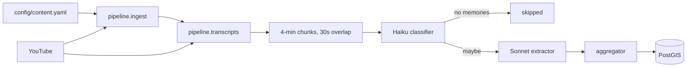
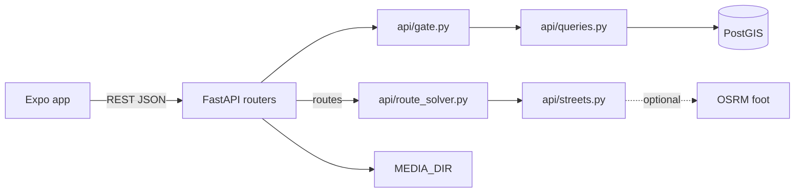

# Architecture

How the parts fit and talk. Where each file lives is in
[repository-map.md](repository-map.md). Why a given call went the way it did is in
[10-decisions.md](10-decisions.md).

## Style

A Python pipeline and a FastAPI server over one PostGIS database, plus an Expo
app, all in one repo. There are no services beyond those two programs and their
backing stores (Postgres, Redis and, optionally, OSRM). The pipeline fills the database
offline. The API is the only thing the app talks to.

## Communication

- **Sync:** the app calls the API with REST/JSON (`mobile/src/api.ts`, one fetch).
  The endpoint list is [06-api.md](06-api.md).
- **Async:** RQ over Redis runs extraction in three queues, classify → extract →
  aggregate (`pipeline/tasks.py`). The sequential path (`pipeline/extract.py`)
  does the same work in one process with no Redis.
- **Outbound:** Anthropic (classify and extract), YouTube (channel listing via
  yt-dlp, transcripts via youtube-transcript-api) and OSRM (walking legs for
  routes; `api/streets.py` falls back to crow-flies × 1.3 when it is absent).





### LLM extraction (`pipeline/extract.py`, sequential)
- Transcripts split into 4-min chunks with 30s overlap
- Claude extracts: place_name, place_query, lat, lng, summary, tags, confidence
- Coordinates come directly from LLM, except a Danish `address`, which DAWA places (`pipeline/geocode.py`)
- Low confidence memories filtered out
- Nearby same-place memories merged (within 60s)

The prompt and its output contract are [04-extract.md](04-extract.md).

### Scaled extraction (`pipeline/tasks.py`, parallel)
Two-stage extraction with Redis queues:
1. **Classify (Haiku)**: Quick check if chunk has location memories (~$0.0001/chunk)
2. **Extract (Sonnet)**: Full extraction only for chunks that pass filter (~$0.003/chunk)

Run multiple workers for parallel processing:
```bash
# Terminal 1-N: Start workers
python -m pipeline.worker

# Or size each queue on its own: Haiku and Sonnet have separate rate limits
python -m pipeline.worker classify   # x2
python -m pipeline.worker extract aggregate   # x4

# Check status
python -m pipeline.enqueue --status <content_id>
```

The reasoning behind the queue shape, and what was designed but never built, is in
[05-scaling-and-api.md](05-scaling-and-api.md).

### Mobile app (`mobile/`)
Expo + react-native-maps. A plan page, a preview, one map that shows only
today's accepted walk, and one detail sheet; the routes endpoints feed it
(`/v1/routes/preview`, `POST`/`GET /v1/routes/today`). Before changing it read
**`mobile/UI.md`** for the design tokens and the constraints that are
load-bearing (never blank or a dead end, foreground-only location), and
**`docs/08-ux-flows.md`** for the flows it has to satisfy.

```bash
cd mobile && npm run typecheck                   # also run by the gate
cd mobile && npx expo start --ios                # see it (UI.md has the recipe)
```

## Data ownership

One database, two writers. Nothing else writes to it.

| Writer | Tables |
|--------|--------|
| Pipeline | `content`, `transcripts`, `extraction_chunks`, `classifier_verdicts`, `places`, `memories` (extracted), `memory_reviews` |
| API | `devices`, `users`, `identities`, `unlocks`, `memory_hearts`, `daily_routes`, `places` + `memories` (submitted), `media`, `reports` |
| Only SQL, for now | `routes`, `route_stops` (authored walks) |

`pipeline/seed_dev.py` and `pipeline/sweep.py` also write the API's tables. They
are dev and maintenance tools, not a third writer. What each table holds is in
[01-setup.md](01-setup.md#schema).

### PostGIS
- Coordinates stored as `GEOGRAPHY(POINT, 4326)`
- Use `ST_DWithin()` for proximity queries
- Index: `idx_places_coordinates` (GIST)

## Security

### Identity

**There are no session tokens anywhere, signed in or not.** `devices` is an
opaque UUID the app generates for itself and keeps in the keychain; the server
never issues one, and it is the only credential — it travels in the request
body, so anybody holding yours can act as you. Same threat model as the unlock's
self-reported position.

Signing in does not change that. Google and Apple hand the app an **ID token**;
the server verifies it (`api/auth.py`) and binds `devices.user_id`. Every
endpoint keeps working unchanged, and a second phone becomes a second device on
one user — which is the whole of what sign-in buys, and why nothing else needed
inventing to get it.

Google and Apple **only**. No passwords: nothing to store, reset, rotate or
leak, and no reset-email flow. Apple is required by App Store review as soon as
any other third-party sign-in exists on iOS, so it is not a preference either.

Two rules in that code are load-bearing and easy to get wrong:

- **Audience is checked.** A valid Google token issued to somebody else's app is
  still a valid Google token. With `GOOGLE_CLIENT_IDS`/`APPLE_CLIENT_IDS` unset
  there is nothing to check against, so `/v1/auth/*` answers **503** rather than
  verifying against nothing.
- **Emails never link accounts.** `identities.email` is recorded and never
  matched on. An address can be reassigned, and Apple's may be a relay.

What survives what, because this is the question that matters and the answer is
not uniform:

| | Survives app data cleared | Survives reinstall | Survives a new phone |
|---|---|---|---|
| Local copy (AsyncStorage) | no | no | no |
| Device id (keychain) | yes | usually | no |
| Server unlocks | yes, via the id | usually | no |

Decisions: [Identity](10-decisions.md#identity).

### Proximity unlock
Only memories you are standing near are readable. The gate is in `row_to_memory`
(`api/gate.py`), not in an endpoint, so every memory-shaped response is redacted
by the same code — `/v1/memories/search` and `/v1/places/nearby`'s
`sample_memory` reach the same rows and would otherwise be side doors.

`api/card.py` renders HTML and cannot use `row_to_memory`, so it gates itself —
if you add another route that emits a summary, it is a hole until you do the
same.

An extracted memory is gated only when no other place shares its coordinate. 121
of 215 placed memories sit on city centroids the model emitted when it did not
know the address, and locking those would ask somebody to walk to a fiction.

A **submitted** memory is always gated: it was filed from the phone of somebody
standing there, so there is no centroid problem to protect anyone from. The
other half of that rule is load-bearing — each submission mints its own place
row, so `COORDINATE_IS_UNIQUE` excludes places carrying one. Without that,
filing a memory outside Katz's puts a second place in the grid cell and unlocks
Katz's for everybody. A gate anybody could open by posting next to it.

Full reasoning in `docs/08-ux-flows.md` F7 and F5 and
[The gate](10-decisions.md#the-gate); assertions in
`tests/test_api_unlock.py` and `tests/test_api_submit.py`.

### Uploads
Three things never come from the client: the filename, the extension, and the
claim about what the bytes are. The extension is looked up from `ALLOWED` by the
declared type, the declared type has to match the file's first bytes, and the
stored name is a fresh uuid. Files are served by `NoSniff`, a `StaticFiles`
subclass that sets `X-Content-Type-Options`, because the extension is what
decides the Content-Type on the way back out and "HTML that says it is a PNG" is
the whole attack. `MEDIA_DIR` is a named volume in `docker-compose.yml`; without
it a rebuild deletes everybody's submissions.

### Abuse
`CORS_ORIGINS` is the only lockdown knob. `REPORT_THRESHOLD` distinct devices hide
a submission. There is no rate limiting yet.

## Deployment

- **Production:** Railway builds the `Dockerfile` (`railway.json`) and probes `/`.
  The container runs `uvicorn api.main:app` on `$PORT`. The Dockerfile's shell-form
  `CMD` is load-bearing: Railway injects `$PORT` at runtime.
- **Local:** `docker compose up -d` starts `db` (PostGIS 16), `redis` and `api`.
  `docker compose --profile routing up -d osrm` adds the walking router once
  `./osrm/build.sh` has run. `start.sh` does the same, waits for the database, and prints the next commands.
- **State that must survive a rebuild:** the Postgres volume and the `MEDIA_DIR`
  volume. Everything else is rebuildable.
- Railway runs only the API. The pipeline runs wherever somebody invokes it, against `DATABASE_URL`.
